<!-- night-sky palette: navy 0D1B3E · blue 3D7BFF · ice BFD9FF · starlight E8F0FF · gold D9B26A -->

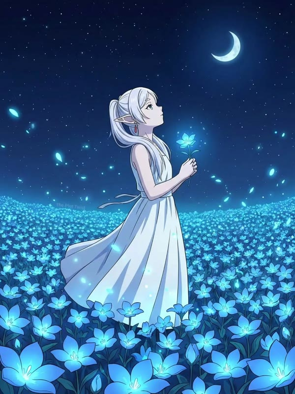

Hi, traveler. I'm a designer who wandered into code. ✦

I collect small spells along the way: Adobe tools, the web, Python,
and lately a little C++. I travel with a few AI familiars too.

I'm not in a hurry. I'd rather make things that linger.

> *Walk slowly. Every road you've crossed leaves a star behind.*

 


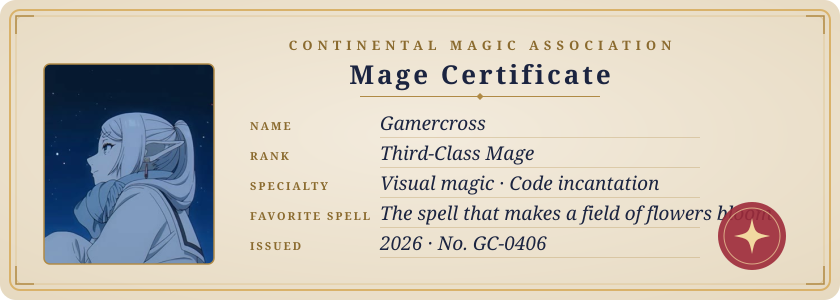

✦ VISUAL SPELLS ✦ 

✦ CODE INCANTATIONS ✦ 

✦ FAMILIARS &amp; ARTIFACTS ✦ 


<a href="https://github.com/gamercross/my-setup-proj"></a>
<a href="https://github.com/gamercross/codyssey"></a>
<a href="https://github.com/gamercross/design-story"></a>
<a href="https://github.com/gamercross/data-ai-assistant"></a>
<a href="https://github.com/gamercross/career-roadmap"></a>
<a href="https://github.com/gamercross/gamercross.github.io"></a>

✦ SEE THEM IN ACTION ✦ &nbsp;
<a href="https://gamercross.github.io/my-setup-proj-story/">Dashboard OS story</a> ·
<a href="https://gamercross.github.io/design-story/">Design Story</a> ·
<a href="https://data-ai-assistant-flame.vercel.app">Data-Aware Familiar</a> ·
<a href="https://gamercross.github.io/career-roadmap/">Wanderer's Map</a> ·
<a href="https://gamercross.github.io/">Home Port</a>

  

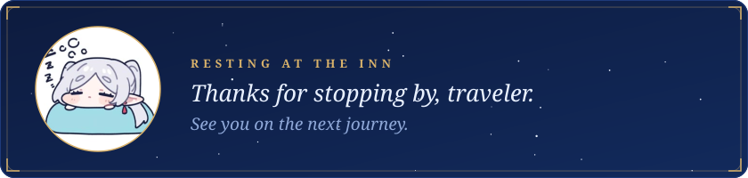

Fan art via Pinterest · night-sky edit by <a href="https://kr.pinterest.com/The_Honored1/">複 | E Z I O</a> · <i>Frieren: Beyond Journey's End</i> © Kanehito Yamada, Tsukasa Abe / Shogakukan

